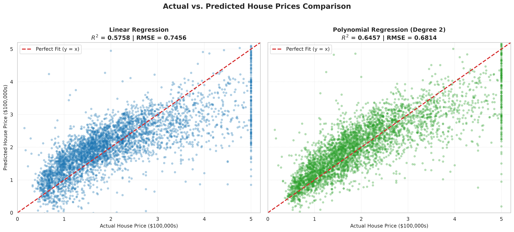
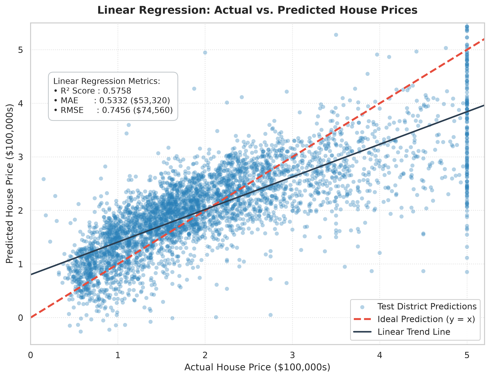
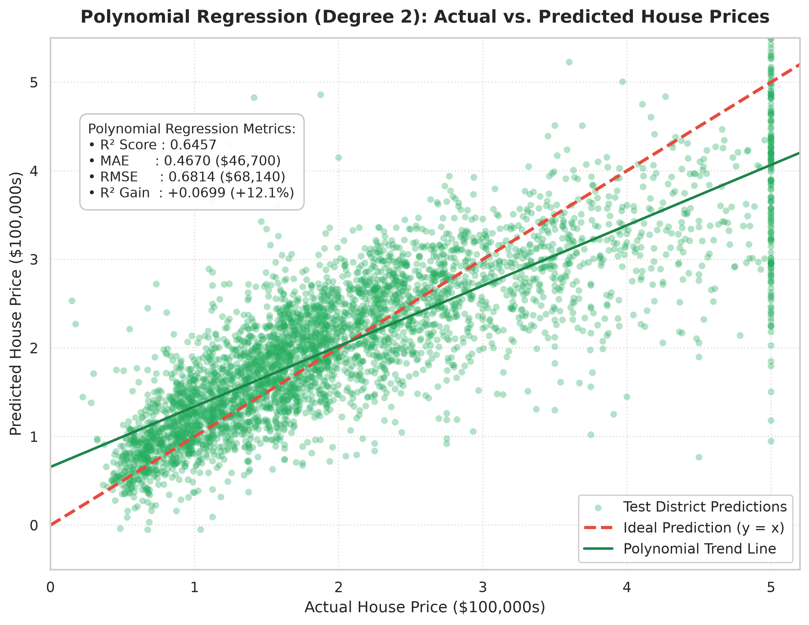
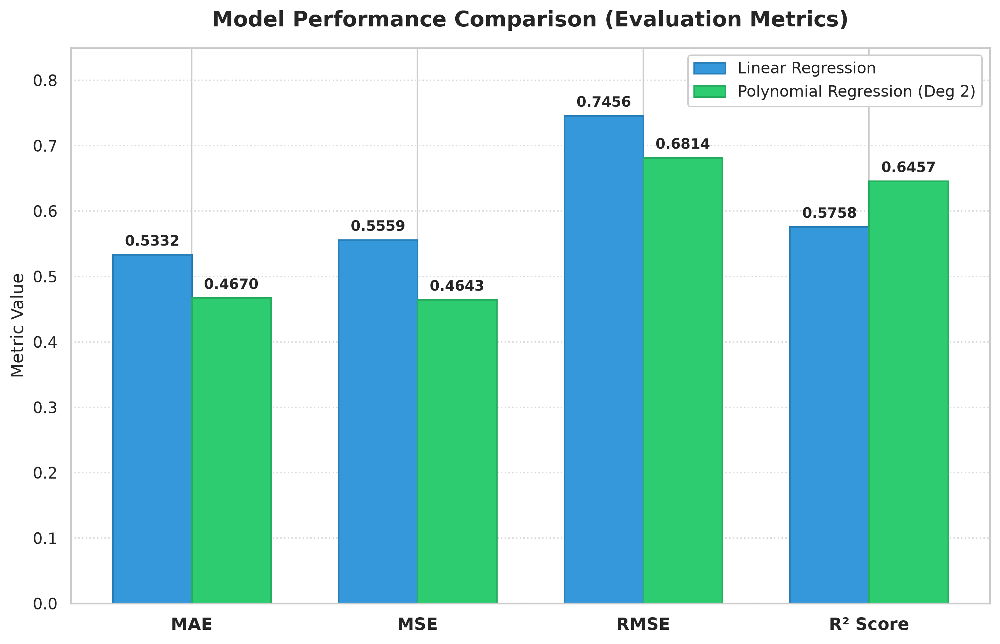
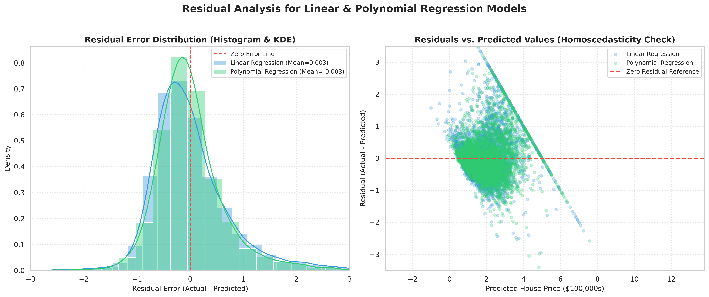

# House Price Prediction Using Linear Regression and Polynomial Regression

[](https://colab.research.google.com/github/Dhinesh8023/House-Price-Prediction-ML/blob/main/house_price_prediction.ipynb)


An end-to-end Machine Learning regression project predicting California district median house prices. This project implements and benchmarks **Multiple Linear Regression** and **Degree-2 Polynomial Regression**, analyzing feature interactions, model assumptions, residual diagnostics, and performance trade-offs.

---

## Table of Contents
1. [Project Overview](#project-overview)
2. [Problem Statement](#problem-statement)
3. [Objectives](#objectives)
4. [Dataset Information](#dataset-information)
5. [Technologies & Tools](#technologies--tools)
6. [Data Preprocessing Pipeline](#data-preprocessing-pipeline)
7. [Regression Algorithms Implemented](#regression-algorithms-implemented)
8. [Evaluation Metrics Explained](#evaluation-metrics-explained)
9. [Actual Model Performance Results](#actual-model-performance-results)
10. [Visualizations & Diagnostic Plots](#visualizations--diagnostic-plots)
11. [Key Insights & Analytical Findings](#key-insights--analytical-findings)
12. [Project Limitations](#project-limitations)
13. [Future Enhancements](#future-enhancements)
14. [Repository Structure](#repository-structure)
15. [Installation & Execution Guide](#installation--execution-guide)
16. [Google Colab Execution](#google-colab-execution)
17. [Conclusion](#conclusion)

---

## Project Overview

Predicting property values is a cornerstone problem in econometric forecasting and real estate analytics. Traditional linear models assume each feature acts independently in an additive fashion. However, real-world housing valuations are driven by non-linear synergies: median income interacts with square footage, and geographic coordinates exhibit non-linear pricing contours (e.g., coastal premiums).

This project benchmarks a **Multiple Linear Regression baseline** against a **Degree-2 Polynomial Regression model** using Scikit-Learn on the benchmark California Housing dataset.

---

## Problem Statement

Given eight continuous socio-demographic and geographic features of California census block groups, build a supervised machine learning regression model to accurately forecast the **median house value (`MedHouseVal`)** expressed in hundreds of thousands of dollars ($100,000s).

---

## Objectives

- Ingest and audit the California Housing dataset via `sklearn.datasets.fetch_california_housing`.
- Conduct exploratory data analysis (EDA), statistical profiling, and correlation assessment.
- Build a leak-free preprocessing pipeline featuring train-test partitioning (80/20, `random_state=42`) and z-score standardization via `StandardScaler`.
- Train and optimize **Multiple Linear Regression** and **Polynomial Regression (Degree 2)** models.
- Quantitatively evaluate and benchmark both models using **MAE**, **MSE**, **RMSE**, and **$R^2$ Score**.
- Produce high-resolution diagnostic plots including actual-versus-predicted plots, metric comparison charts, and residual distributions.
- Discuss mathematical reasons for model behavior, dataset limitations (such as target capping), and production considerations.

---

## Dataset Information

The project uses the **California Housing Dataset** from Scikit-Learn (derived from the 1990 U.S. Census).

### Dataset Dimensions:
- **Total Records (Census Block Groups)**: `20,640`
- **Feature Count**: `8` continuous input variables
- **Target Variable**: `1` continuous variable (`MedHouseVal`)
- **Missing Values**: `0` (clean dataset)

### Feature Glossary:

| Feature | Type | Description | Measurement Units |
| :--- | :--- | :--- | :--- |
| `MedInc` | Float | Median income in census block group | Tens of thousands of USD ($10,000s) |
| `HouseAge` | Float | Median house age in census block group | Years |
| `AveRooms` | Float | Average rooms per household | Rooms / Household |
| `AveBedrms` | Float | Average bedrooms per household | Bedrooms / Household |
| `Population` | Float | Total population in block group | Persons |
| `AveOccup` | Float | Average household members | Persons / Household |
| `Latitude` | Float | Block group geographic latitude | Degrees North |
| `Longitude` | Float | Block group geographic longitude | Degrees West |
| **`MedHouseVal`** | Float | **Target Variable**: Median home value | Hundreds of thousands of USD ($100,000s) |

> **Target Note**: A target value of `2.0` corresponds to **$200,000**. House values exceeding $500,000 were capped at `5.00001` during census collection.

---

## Technologies & Tools

- **Language**: Python 3.9+
- **Machine Learning**: `scikit-learn` (`LinearRegression`, `PolynomialFeatures`, `StandardScaler`, `train_test_split`, `metrics`)
- **Data Manipulation**: `pandas`, `numpy`
- **Data Visualization**: `matplotlib`, `seaborn`
- **Interactive Computing**: `Jupyter Notebook`, `Google Colab`
- **Version Control**: `Git`, `GitHub`

---

## Data Preprocessing Pipeline

1. **Missing Value Audit**: Verified zero missing/null values across all 20,640 records.
2. **Feature-Target Separation**: Partitioned data into predictor matrix $X \in \mathbb{R}^{20640 \times 8}$ and target vector $y \in \mathbb{R}^{20640}$.
3. **Train-Test Split**:
   - 80% Training Set (`16,512` samples)
   - 20% Testing Set (`4,128` samples)
   - Fixed random state: `random_state=42`
4. **Feature Standardization (`StandardScaler`)**:
   - Standardized features to zero mean ($\mu = 0$) and unit variance ($\sigma = 1$).
   - Fit strictly on the training partition (`X_train`) and transformed test partition (`X_test`) to prevent data leakage.
   - Essential for balancing coefficient scales across divergent units (e.g., `Population` in thousands vs. `AveRooms` < 10).

---

## Regression Algorithms Implemented

### 1. Multiple Linear Regression
Models the target variable as a direct weighted linear combination of standardized features:

$$\hat{y} = \beta_0 + \sum_{j=1}^p \beta_j x_j$$

- **Learned Intercept ($\beta_0$)**: `2.0719`
- **Top Positive Coefficient**: `MedInc` ($\beta \approx +0.8543$)
- **Top Negative Coefficient**: `Latitude` & `Longitude` (reflecting California's south/west coastal pricing gradient)

### 2. Polynomial Regression (Degree 2)
Expands the 8 original standardized features into degree-2 polynomial combinations:

$$\hat{y} = \beta_0 + \sum_{i=1}^p \beta_i x_i + \sum_{i=1}^p \beta_{ii} x_i^2 + \sum_{i=1}^p \sum_{j > i}^p \beta_{ij} x_i x_j$$

- **Feature Count Expansion**: From `8` to `44` features (8 original linear terms + 8 squared terms + 28 cross-interaction terms).
- Captures quadratic returns (e.g., non-linear price deceleration with age) and cross-term interactions (e.g., `MedInc` $\times$ `AveRooms`, `Latitude` $\times$ `Longitude`).

---

## Evaluation Metrics Explained

| Metric | Mathematical Formula | Simple English Explanation |
| :--- | :--- | :--- |
| **Mean Absolute Error (MAE)** | $\frac{1}{n} \sum \|y_i - \hat{y}_i\|$ | The average dollar distance between actual and predicted prices. Robust against extreme outliers. |
| **Mean Squared Error (MSE)** | $\frac{1}{n} \sum (y_i - \hat{y}_i)^2$ | The average of squared errors. Heavily penalizes large forecasting mistakes. |
| **Root Mean Squared Error (RMSE)** | $\sqrt{\text{MSE}}$ | Standard deviation of prediction errors. Expressed in the exact same units as house prices ($100,000s). |
| **$R^2$ Score** | $1 - \frac{\sum (y_i - \hat{y}_i)^2}{\sum (y_i - \bar{y})^2}$ | Coefficient of Determination. Measures the percentage of variance in house prices explained by the model (1.0 = perfect model). |

---

## Actual Model Performance Results

*All values below were computed from model execution on the unseen testing set (4,128 districts, `random_state=42`):*

| Evaluation Metric | Multiple Linear Regression | Polynomial Regression (Degree 2) | Performance Improvement |
| :--- | :---: | :---: | :---: |
| **Mean Absolute Error (MAE)** | **`0.5332`** ($53,320) | **`0.4670`** ($46,700) | **+12.42% Error Reduction** |
| **Mean Squared Error (MSE)** | **`0.5559`** | **`0.4643`** | **+16.48% Error Reduction** |
| **Root Mean Squared Error (RMSE)** | **`0.7456`** ($74,558) | **`0.6814`** ($68,140) | **+8.61% Error Reduction** |
| **Coefficient of Determination ($R^2$)**| **`0.5758`** (57.58%) | **`0.6457`** (64.57%) | **+12.14% Variance Explained** |

### Sample Predictions (First 10 Test Districts):

| Actual Price ($100k) | Actual Price (USD) | Linear Regression Predicted | Polynomial Regression Predicted | Best Model on Sample |
| :---: | :---: | :---: | :---: | :---: |
| **$0.4770** | $47,700 | $0.7191 ($71,910) | **$0.5540** ($55,400) | **Polynomial** |
| **$0.4580** | $45,800 | $1.7640 ($176,400) | **$1.7512** ($175,120) | **Polynomial** |
| **$5.0000** | $500,000 | $2.7097 ($270,970) | **$3.4924** ($349,240) | **Polynomial** |
| **$2.1860** | $218,600 | **$2.8389** ($283,890) | $2.8497 ($284,970) | **Linear** |
| **$2.7800** | $278,000 | $2.6047 ($260,470) | **$2.7624** ($276,240) | **Polynomial** |
| **$1.5870** | $158,700 | $2.0118 ($201,180) | **$1.9135** ($191,350) | **Polynomial** |
| **$1.9820** | $198,200 | **$2.6455** ($264,550) | $2.6648 ($266,480) | **Linear** |
| **$1.5750** | $157,500 | $2.1688 ($216,880) | **$2.0154** ($201,540) | **Polynomial** |
| **$3.4000** | $340,000 | $2.7407 ($274,070) | **$2.8938** ($289,380) | **Polynomial** |
| **$4.4660** | $446,600 | $3.9156 ($391,560) | **$3.9675** ($396,750) | **Polynomial** |

---

## Visualizations & Diagnostic Plots

All plots are saved in the `results/` folder at 300 DPI:

### 1. Actual vs. Predicted House Prices Comparison
Dual-panel comparison of testing samples against the ideal $y = x$ reference line. Shows tighter clustering and higher density along the diagonal for Polynomial Regression.



---

### 2. Linear Regression Prediction Visualization
Detailed scatter plot of Linear Regression predictions showing the linear fitted trendline, $R^2 = 0.5758$, and prediction dispersion across price ranges.



---

### 3. Polynomial Regression Prediction Visualization
Scatter plot of Polynomial Regression predictions demonstrating the non-linear curvature capture, $R^2 = 0.6457$, and tighter bounds.



---

### 4. Model Performance Comparison Chart
Side-by-side grouped bar chart illustrating MAE, MSE, RMSE, and $R^2$ Score across both models with annotated metric values.



---

### 5. Residual Analysis & Homoscedasticity Diagnostics
Diagnostic analysis confirming zero-centered normal distribution of residuals, followed by a residual-versus-predicted homoscedasticity check highlighting the $500k ceiling boundary.



---

## Key Insights & Analytical Findings

1. **Superiority of Polynomial Regression**:
   - $R^2$ rose from **0.5758 to 0.6457**, explaining an additional **7% of total variance** (a 12.14% relative gain).
   - MAE dropped by **$6,620** per property, demonstrating that non-linear feature combinations meaningfully reduce dollar error.
2. **Geographic Interaction Drivers**:
   - California housing prices are geographically non-linear. The interaction terms $\text{Latitude} \times \text{Longitude}$, $\text{Latitude}^2$, and $\text{Longitude}^2$ allow the model to approximate coastal proximity and urban hub effects (San Francisco Bay Area and Los Angeles Basin).
3. **Socio-Economic Compounding**:
   - The interaction term between `MedInc` and `AveRooms` accounts for neighborhoods where high income and larger floor plans jointly amplify market value.
4. **Data Censoring Artifact**:
   - In the residual plots, a distinct diagonal ceiling appears at actual price = 5.0 ($500,000). The census capped values above $500k, leading both models to underestimate the true market value of luxury properties.

---

## Project Limitations

- **Feature Dimensionality**: Expanding degree to $d = 3$ creates 165 features, triggering multicollinearity and risking severe test overfitting.
- **Absence of Modern Valuation Signals**: The dataset lacks parcel square footage, school ratings, transit proximity, and historical interest rate indices.
- **Truncated Upper Bound**: Capping at $500,000 prevents accurate prediction of luxury real estate.

---

## Future Enhancements

- **Regularized Regression**: Introduce **Ridge (L2)**, **Lasso (L1)**, and **ElasticNet** regularization to penalize over-weighted polynomial cross-terms.
- **Geospatial Feature Engineering**: Compute explicit geodesic distance to coastal shorelines and major employment clusters.
- **Non-Linear Tree Ensembles**: Benchmark against **Random Forest Regressor**, **XGBoost**, and **LightGBM** for state-of-the-art tabular accuracy.

---

## Repository Structure

```
House-Price-Prediction-ML/
│
├── README.md                      # Comprehensive project documentation
├── house_price_prediction.ipynb   # Complete Google Colab executable notebook
├── house_price_prediction.py      # Standalone end-to-end Python script
├── requirements.txt               # Pinned Python package dependencies
├── .gitignore                     # Git ignore rules for clean repository
│
└── results/                       # High-resolution 300 DPI visualizations
    ├── actual_vs_predicted.png    # Actual vs Predicted comparison plot
    ├── linear_regression.png      # Linear Regression prediction plot
    ├── polynomial_regression.png  # Polynomial Regression prediction plot
    ├── model_comparison.png       # Grouped bar chart comparing metrics
    └── residual_analysis.png      # Residual distribution & error diagnostics
```

---

## Installation & Execution Guide

### 1. Clone the Repository
```bash
git clone https://github.com/Dhinesh8023/House-Price-Prediction-ML.git
cd House-Price-Prediction-ML
```

### 2. Set Up a Python Virtual Environment
```bash
# Windows
python -m venv venv
venv\Scripts\activate

# macOS / Linux
python3 -m venv venv
source venv/bin/activate
```

### 3. Install Dependencies
```bash
pip install -r requirements.txt
```

### 4. Execute the Standalone Python Pipeline
```bash
python house_price_prediction.py
```
*This command executes the full data preprocessing, trains both models, prints comparison tables and insights to the terminal, and saves all 5 figures to the `results/` directory.*

---

## Google Colab Execution

You can run this entire project interactively in your browser with zero local setup:

1. Click the **Open In Colab** badge:
   
   [](https://colab.research.google.com/github/Dhinesh8023/House-Price-Prediction-ML/blob/main/house_price_prediction.ipynb)

2. Navigate to **Runtime -> Run all** (or press `Ctrl+F9`).
3. View all interactive tables, correlation heatmaps, model predictions, and diagnostic plots directly in your Colab session.

---

## Conclusion

This project delivers a complete, reproducible Machine Learning workflow for regression modeling. Moving from Multiple Linear Regression to Degree-2 Polynomial Regression increased model explanatory power from **57.58% to 64.57%**, lowering average absolute prediction errors to **$46,700**. The results demonstrate the critical role of non-linear feature engineering when modeling real-world physical and geospatial phenomena.

---

## Author

- **GitHub**: [@Dhinesh8023](https://github.com/Dhinesh8023)
- **Project**: House-Price-Prediction-ML
- **License**: [MIT License](LICENSE)
